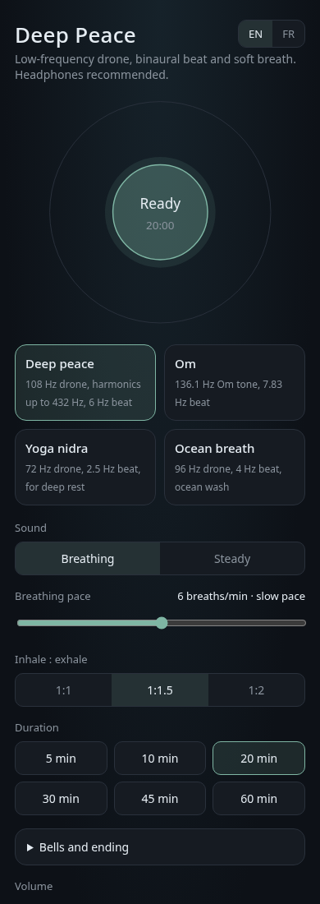

# Deep Peace

**A zero-dependency, low-frequency yoga sound app: a deep drone, a binaural beat and a slow breathing guide, in one HTML file.**

---

## Screenshots

| Phone view |
|---|
|  |

## Contents

- [Use it](#use-it)
- [Features](#features)
- [Presets](#presets)
- [How it works](#how-it-works)
- [Repository](#repository)

## Use it

Open **https://fschmutz.github.io/DEEP-PEACE/**, pick a sound and a duration, tap **Begin**. Headphones are recommended for the binaural beat.

**On iPhone, add it to the Home Screen:** open the link in Safari → Share → *Add to Home Screen* (Chrome on iOS 16.4+ also offers it under Share). It then opens full screen, works offline, and keeps playing with the screen locked, with play/stop on the lock screen.

## Features

- **Lock-screen playback** — the Web Audio graph plays through a hidden `<audio>` element fed by a `MediaStreamAudioDestinationNode`, with `navigator.audioSession.type = 'playback'` where supported, so iOS treats it as media: it keeps going with the screen locked and is not muted by the silent switch. If the stream element is refused, output falls back to the plain audio context.
- **Lock-screen controls** — Media Session title, preset, artwork, play/pause/stop and position.
- **Home Screen app, offline** — `manifest.webmanifest`, icons, and a cache-first service worker (`sw.js`, versioned cache; a new version reloads the page when nothing is playing).
- **Breathing pace** — 4 to 8 breaths per minute (default 6) and inhale:exhale of 1:1, 1:1.5 or 1:2. The pace drives the circle and the noise swell, scheduled on the audio clock so it continues with the screen locked. Hidden in Steady mode.
- **Singing bowl** — a synthesized bowl (inharmonic partials with slow beating) at start and end, and an optional interval bell every 5 or 10 minutes.
- **Slow fade at the end** — optional 5 or 10 minute fade-out instead of the 3 s stop.
- **Breathing / Steady**, **EN / FR** — as before; every choice is remembered on the device.

Nothing here is a medical claim: it is a sound to relax and breathe with.

## Presets

| Preset | Drone | Beat |
|---|---|---|
| Deep peace | 108 Hz, harmonics up to 432 Hz | 6 Hz (theta) |
| Om | 136.1 Hz | 7.83 Hz |
| Yoga nidra | 72 Hz | 2.5 Hz (delta) |
| Ocean breath | 96 Hz | 4 Hz |

- **Breathing / Steady** — Breathing (default) gives the binaural beat, a breath-paced swell and the in/out guide. Steady removes every variation: both ears get the same tone, the noise stays constant, no detune shimmer, and the circle stays still while the countdown runs. Works with every preset. The page remembers your choice.
- **EN / FR** — the switch at the top translates the whole interface. The first visit follows the browser language, and the page remembers your choice.

Timers: 5, 10, 20, 30, 45 or 60 minutes. Start fades in over 4 s, Stop fades out over 3 s.

## How it works

The app is `index.html` (plain HTML, CSS and JavaScript on the Web Audio API) plus `manifest.webmanifest`, `sw.js` and `icons/`. No framework, no npm, no CDN, no web font, no build step, no network request after the page loads.

- **Binaural beat** — the left ear gets the base frequency, the right ear base + beat, joined by a `ChannelMerger`.
- **Pad** — a few harmonics of the base through a low-pass filter.
- **Breath** — looping brown-ish noise whose level and brightness swell with the chosen pace; the circle on screen follows it.

GitHub Pages serves the file straight from `main` at the repository root.

## Repository

Made from the house GitHub template ([`ScaleMeNow/GITHUB-TEMPLATE`](https://github.com/ScaleMeNow/GITHUB-TEMPLATE)) with bundles **A–E** on, as for any public toy. Documentation lives in [`wiki/`](wiki/Home.md); conventions are in [`CONTRIBUTING.md`](CONTRIBUTING.md) and [`AGENTS.md`](AGENTS.md).
