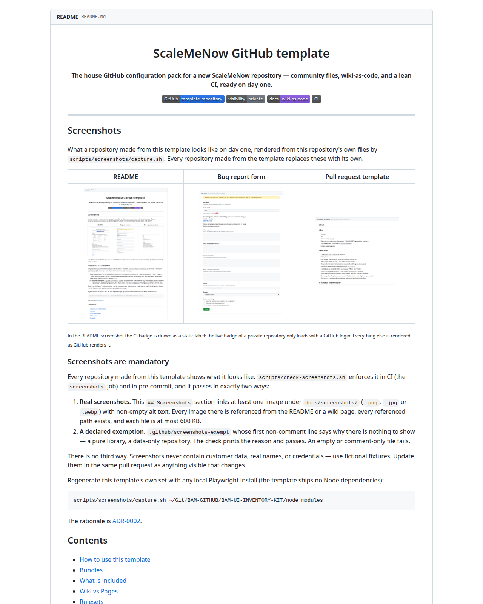
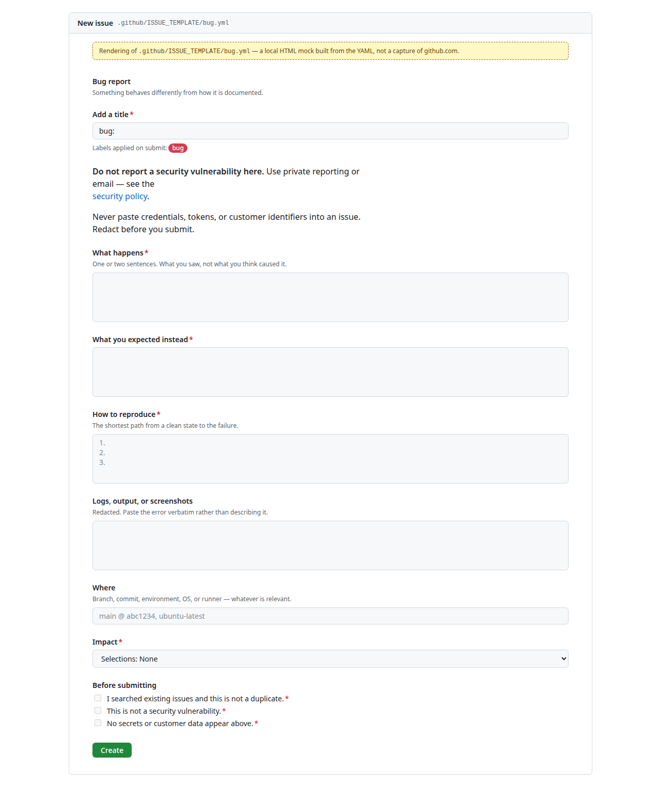
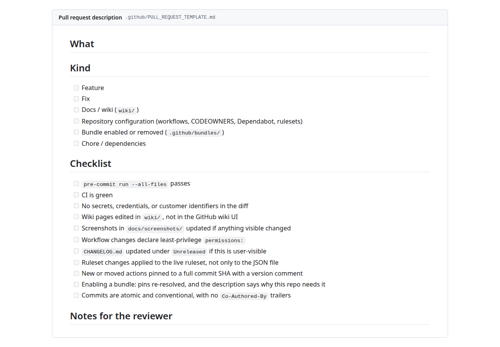

<div align="center">

# ScaleMeNow GitHub template

**The house GitHub configuration pack for a new ScaleMeNow repository — community files, wiki-as-code, and a lean CI, ready on day one.**

[](https://github.com/ScaleMeNow/GITHUB-TEMPLATE/generate)
[](#)
[](https://github.com/ScaleMeNow/GITHUB-TEMPLATE/wiki)
[](https://github.com/ScaleMeNow/GITHUB-TEMPLATE/actions/workflows/ci.yml)

</div>

---

## Screenshots

What a repository made from this template looks like on day one, rendered from this repository's own files by `scripts/screenshots/capture.sh`. Every repository made from the template replaces these with its own.

| README | Bug report form | Pull request template |
|---|---|---|
|  |  |  |

<sub>In the README screenshot the CI badge is drawn as a static label: the live badge of a private repository only loads with a GitHub login. Everything else is rendered as GitHub renders it.</sub>

### Screenshots are mandatory

Every repository made from this template shows what it looks like. `scripts/check-screenshots.sh` enforces it in CI (the `screenshots` job) and in pre-commit, and it passes in exactly two ways:

1. **Real screenshots.** This `## Screenshots` section links at least one image under `docs/screenshots/` (`.png`, `.jpg` or `.webp`) with non-empty alt text. Every image there is referenced from the README or a wiki page, every referenced path exists, and each file is at most 600 KB.
2. **A declared exemption.** `.github/screenshots-exempt` whose first non-comment line says why there is nothing to show — a pure library, a data-only repository. The check prints the reason and passes. An empty or comment-only file fails.

There is no third way. Screenshots never contain customer data, real names, or credentials — use fictional fixtures. Update them in the same pull request as anything visible that changes.

Regenerate this template's own set with any local Playwright install (the template ships no Node dependencies):

```bash
scripts/screenshots/capture.sh /path/to/node_modules
```

The rationale is [ADR-0002](wiki/ADR/0002-Screenshots-Are-Mandatory.md).

## Attribution is checked

The author of record is the human who owns the change. `scripts/attribution-guard.sh`
runs as the `attribution guard` job on every pull request and fails it when:

- a commit's **author or committer address** is not in `.github/attribution-allow.txt`
  — the exception list is `committer:` for a GitHub web merge, `bot:` for
  `dependabot[bot]`, `github-actions[bot]` and `renovate[bot]`;
- a commit's **author or committer name** reads as a tool — `Cursor Agent`,
  `Claude`, `Copilot`, `AI assistant` — which fails even when the address is
  allow-listed, because an assistant committing through somebody's account
  still signs the history with its own name. A person whose name collides
  needs a `name:` line in the same file; that is the only way past it;
- a commit message carries a **`Co-authored-by:` trailer** naming anyone who is
  not on that list, or an **assistant footer** — a "Generated with …" line, an
  agent run link, a robot emoji;
- the **pull request title or body** carries agent body markers, an agent run
  link, an "Open in …" footer image, or the same "Generated with …" footer.
  Both are re-read from the API when the description is edited, so a footer
  pasted in after the last push is still seen.

It is deliberately narrow about prose: only footer shapes, trailer keys, and
URLs count, and a tool's name in the middle of a sentence is prose, so a commit
about closing a database cursor passes and so does one that explains this
check. Widening the
allow-list is a reviewed commit of its own, never a step on the way to green —
and deleting the file does not widen it either, since a missing or unreadable
allow-list warns and falls back to the address built into the script.

## Contents

- [Attribution is checked](#attribution-is-checked)
- [How to use this template](#how-to-use-this-template)
- [Bundles](#bundles)
- [What is included](#what-is-included)
- [Wiki vs Pages](#wiki-vs-pages)
- [Rulesets](#rulesets)
- [What this template deliberately leaves out](#what-this-template-deliberately-leaves-out)
- [Conventions](#conventions)

## How to use this template

1. **GitHub → `Use this template` → `Create a new repository`.** Keep it private unless the repo is meant to be public.
2. **Bring the wiki up** — three steps, and none of them happens on its own: enable Wikis (Settings → Features), create one throwaway page in the Wiki tab, then run the `wiki` workflow by hand (Actions → `wiki` → *Run workflow*). [Getting Started](https://github.com/ScaleMeNow/GITHUB-TEMPLATE/wiki/Getting-Started) explains why each is needed.
3. **Replace the placeholders.** These files carry them:

| File | Replace |
|---|---|
| `.github/CODEOWNERS` | add path owners; keep a real human on `*` |
| `.github/attribution-allow.txt` | the addresses that may author or commit here |
| `SECURITY.md` | the reporting contact and the scope paragraph |
| `.github/ISSUE_TEMPLATE/config.yml`, `bug.yml` | `ScaleMeNow/GITHUB-TEMPLATE` → your `OWNER/REPO` |
| `SUPPORT.md` | the wiki and issue-form links, same `OWNER/REPO` swap |
| `README.md` | this file — hero, badges, and purpose line |
| `wiki/Home.md` | the repo name, what the repo actually does, and the raw screenshot URLs |
| `wiki/Bundles.md` | the links to the bundle READMEs, same `OWNER/REPO` swap |
| `docs/screenshots/` | the template's images → your own, linked from `## Screenshots` in the README and `wiki/Home.md` — or a reason in `.github/screenshots-exempt` |

4. **Rename the badge URLs** in the README hero to your `OWNER/REPO`, or the CI badge will track this template instead of your repo.
5. **Apply a ruleset** — see [Rulesets](#rulesets). Nothing in `.github/rulesets/` enforces itself.
6. **Install the hooks** locally: `pipx install pre-commit && pre-commit install`.

7. **Pick your bundles** — see [Bundles](#bundles). A fresh clone is already A–E; F, G, and H are present and switched off.

A quick sanity pass: `grep -rn "GITHUB-TEMPLATE" . --exclude-dir=.git` should return only lines you meant to keep. It also catches the raw screenshot URLs in `wiki/Home.md`.

## Bundles

Everything researched for this template ships with it, grouped into named bundles with a declared default. Nothing is a flat dump that every clone has to run.

- **On** — an active file in its normal place.
- **Off** — an inert file under `.github/bundles/`, suffixed `.disabled` or `.example`. GitHub reads it as neither a workflow nor a community file. Present, readable, reviewed, and one `git mv` from working.

CI enforces the second half: `template structure` fails if any file under `.github/bundles/` loses its suffix, so a bundle turns on deliberately or not at all.

| Bundle | Default | How to enable | How to remove |
|---|---|---|---|
| **A — Core** | **on** | Always present. It is the template. | Don't. |
| **B — Agent**<br>`AGENTS.md`, `CLAUDE.md`, `.github/copilot-instructions.md` | **on** | Already active | `git rm` the three files, then drop them from the path list in `ci.yml` |
| **C — Supply chain**<br>SHA pins + `dependency-review.yml` | **on** | Already active | `git rm .github/workflows/dependency-review.yml`; keep the pins |
| **D — Triage**<br>`labels.yml`, `labeler.yml`, two workflows, `docs.yml`, `SUPPORT.md` | **on** | Already active | `git rm` the label files and their workflows |
| **E — Governance**<br>ruleset example, `apply-ruleset.sh`, `wiki/ADR/` | **on** (files)<br>**opt-in** (enforcement) | `./scripts/apply-ruleset.sh --apply` | `git rm -r .github/rulesets scripts/apply-ruleset.sh wiki/ADR`, and delete the live ruleset |
| **F — Release**<br>release-please, SBOM | **off** | `git mv .github/bundles/release/<f>.yml.disabled .github/workflows/<f>.yml` | `git rm -r .github/bundles/release` |
| **G — Public / community**<br>code of conduct, funding, `llms.txt`, stale bot | **off** | `git mv` each `.example` to its real name | `git rm -r .github/bundles/community` |
| **H — Heavy security**<br>OpenSSF Scorecard | **off** | `git mv .github/bundles/security/scorecard.yml.disabled .github/workflows/scorecard.yml` — **keep the `workflow_dispatch`-only trigger** | `git rm -r .github/bundles/security` |
| **I — Estate**<br>future shared reusable workflows | docs only | Nothing to enable — see below | Nothing to remove |

Two steps before you enable anything from F, G, or H, every time:

1. **Re-resolve the pinned action SHAs.** Dependabot only scans `.github/workflows/`, so the pins under `.github/bundles/` are frozen at the day the bundle was written.
2. **Read the header comment in the file.** Each one says what it costs to run and what it needs from repository settings. None of them is free.

Each bundle directory has its own README with the details. [Bundles](https://github.com/ScaleMeNow/GITHUB-TEMPLATE/wiki/Bundles) in the wiki has the full reasoning, and [ADR-0001](wiki/ADR/0001-Ship-Enhancements-As-Bundles.md) records why it is shaped this way.

### Different products use different bundles

| Shape | Bundles | Why |
|---|---|---|
| **Private operator repo** — runbooks, infrastructure, internal tooling | **A–E** (the default) | Everything it needs, nothing it has to pay for. A fresh clone already is this. |
| **Public toy or demo** | **A–E + G** | Replace `LICENSE`, scan the whole history, and read the community README *before* flipping visibility. |
| **Shipping artifact** — library, image, CLI | **A–F** | Release automation and SBOM start earning the moment somebody outside the repository depends on a version number. |
| **Platform beast** — sustained traffic, real build, real blast radius | **A–F**, and peek at the ENGINE estate rather than at Scorecard | At that size the answer is the platform repository's own CI, borrowed deliberately. Scorecard-on-push bills like a build and reports like a checklist. |

The rule underneath all four: enable a bundle because *this* repository needs it, not because another repository has it.

### I — Estate: shared workflows

The bundles duplicate workflow logic across every repository that enables them. The estate-level answer is one repository of reusable workflows, called as `uses: OWNER/ACTIONS-REPO/.github/workflows/<name>.yml@<sha>`, so a fix lands once instead of once per clone.

**It does not exist, and this template does not create it.** A shared workflow repository needs its own ownership, versioning, and release path, and it becomes a single point of failure for everything that calls it — worth paying for at ten repositories with the same job, not at two. When it happens, Bundles C, F, and H move first: their logic is identical everywhere and their pins go stale fastest.

## What is included

| Path | What it does | Bundle |
|---|---|---|
| `README.md` | Hero, badges, TOC — the first thing a human sees | A |
| `CHANGELOG.md` | Keep a Changelog stub with an `Unreleased` section | A |
| `SECURITY.md` | Private reporting path; no public issues for vulnerabilities | A |
| `SUPPORT.md` | Where to ask a question, and where not to | D |
| `CONTRIBUTING.md` | Branch, PR, commit, and secret-handling conventions | A |
| `AGENTS.md` | The house contract for every AI assistant | B |
| `CLAUDE.md` | Pointer to `AGENTS.md` plus Claude-specific notes | B |
| `LICENSE` | Proprietary — all rights reserved | A |
| `.gitignore` | OS, editor, secret, Node, and Python noise | A |
| `.pre-commit-config.yaml` | `gitleaks` + `actionlint` + generic hygiene + screenshots | A |
| `docs/screenshots/` | The repository's screenshots — images only, no prose | A |
| `scripts/check-screenshots.sh` | Enforces the screenshot rule; generic, copied byte-identical elsewhere | A |
| `scripts/check-doc-surface.sh` | Enforces one doc surface: only `docs/screenshots/` under `docs/`, no wiki link into `docs/`, except paths declared with a reason in `.github/doc-surface-exceptions.txt`; copied byte-identical elsewhere | A |
| `scripts/attribution-guard.sh` | Fails a pull request signed by anyone but its owner; generic, copied byte-identical elsewhere | A |
| `scripts/tests/` | Fixtures and a plain-bash runner for `attribution-guard.sh` | A |
| `scripts/screenshots/` | Captures this template's own screenshots (maintainer tool) | A |
| `wiki/` | The source of truth for the GitHub wiki | A |
| `wiki/Bundles.md` | The bundle map, in full | A |
| `wiki/ADR/` | Architecture decision records and their template | E |
| `scripts/wiki-sync.sh` | Mirrors `wiki/` into `<repo>.wiki.git` | A |
| `scripts/apply-ruleset.sh` | Plans and applies the branch ruleset, by hand | E |
| `scripts/check-repo-settings.sh` | Checks the live About, features, merge, security and ruleset settings; `--apply` sets the settable ones | A |
| `.github/CODEOWNERS` | Review ownership, including `/.github/` | A |
| `.github/dependabot.yml` | `github-actions` + `pre-commit`, weekly | A |
| `.github/copilot-instructions.md` | The same contract, compact, for Copilot | B |
| `.github/PULL_REQUEST_TEMPLATE.md` | What / Kind / Checklist | A |
| `.github/ISSUE_TEMPLATE/` | Bug, feature, and docs forms; blank issues disabled | A, D |
| `.github/labels.yml` | The label set, as reviewable data | D |
| `.github/labeler.yml` | Path-to-label rules for pull requests | D |
| `.github/workflows/ci.yml` | Workflow syntax, template structure, SHA pins, bundles-still-off, screenshots | A |
| `.github/workflows/attribution-guard.yml` | Runs the attribution guard on every pull request, `edited` included | A |
| `.github/attribution-allow.txt` | Who may author, commit, or be co-authored here | A |
| `.github/workflows/wiki.yml` | Publishes `wiki/` on every push to the default branch | A |
| `.github/workflows/dependency-review.yml` | Blocks high/critical advisories on dependency changes | C |
| `.github/workflows/label-sync.yml` | Applies `labels.yml` to the repository | D |
| `.github/workflows/labeler.yml` | Labels a pull request from the paths it touches | D |
| `.github/gitleaks.toml` | Minimal config, empty allowlist | A |
| `.github/rulesets/main.example.json` | Branch-protection shape, applied out of band | E |
| `.github/rulesets/multi-branch.example.json` | The same shape for `dev`/`preprod`/`prod` repositories | E |
| `.github/bundles/` | Present and inert: `.disabled` and `.example` files | F, G, H |

## Wiki vs Pages

This template ships **one** documentation surface: the `wiki/` directory, mirrored to the GitHub wiki by `.github/workflows/wiki.yml`.

- Write pages in `wiki/`, review them in a PR, and the merge publishes them.
- **Do not edit pages in the GitHub wiki UI** — the sync overwrites them on the next push.
- There is no Pages configuration and no prose under `docs/`, on purpose. Two documentation sources drift, and the one nobody owns is the one people read. The one exception is `docs/screenshots/` — images, not documentation ([ADR-0002](wiki/ADR/0002-Screenshots-Are-Mandatory.md)) — and CI fails on anything else under `docs/`.

If a repo genuinely needs public Pages, drop `wiki/`, `scripts/wiki-sync.sh`, and `.github/workflows/wiki.yml` first. Pick one surface.

## Rulesets

`.github/rulesets/main.example.json` is **documentation, not enforcement.** A JSON file in the repository does nothing until someone creates the ruleset, and nothing here creates it for you — a template that applied branch protection on every clone would lock a repository before anyone had decided who owns it.

`scripts/apply-ruleset.sh` is the deliberate step. It plans by default and only writes when you say so:

```bash
./scripts/apply-ruleset.sh                   # show what it would do
./scripts/apply-ruleset.sh --apply           # create it, or update it in place
./scripts/apply-ruleset.sh -R OWNER/REPO --apply
```

The plan checks every `required_status_checks` context against the job names your workflows actually produce, because requiring a check that never reports blocks every pull request permanently. Two of the checks this template ships — `dependency review` and `label by path` — are path-filtered and deliberately do **not** belong in that list.

The raw API call and Settings → Rules → Rulesets → New branch ruleset both work too.

The example lists the repository **admin role as a bypass actor**, because the owner pushing directly to `main` is the norm in BAM repositories. Everyone else goes through a pull request and the required checks. Drop the bypass only if the owner should go through pull requests too.

A multi-branch pipeline repository (`dev`, `preprod`, `prod` at one SHA, a push deploys) applies `.github/rulesets/multi-branch.example.json` instead: same rules and bypass, targeting the three deploy branches, with the repository's own build jobs added to `required_status_checks`. Run `./scripts/apply-ruleset.sh -f .github/rulesets/multi-branch.example.json`. The full variant is on the [Getting Started](https://github.com/ScaleMeNow/GITHUB-TEMPLATE/wiki/Getting-Started#multi-branch-repositories) wiki page.

## What this template deliberately leaves out

Copy from the platform repositories on purpose, never by reflex. In particular, **do not copy a production platform's CI estate** into a new repo — it is dozens of workflows sized for something else, and it is billed runner minutes on a repo that has nothing to build yet.

Absent from the tree entirely, and each for a reason:

| Not included | Why |
|---|---|
| SonarCloud / external code scanners | Per-repo setup cost with no default value |
| Merge queue | Needs sustained PR volume to pay for itself |
| AWS deploy workflows | Deployment belongs to the repo that owns the infrastructure |
| GitHub Pages | See [Wiki vs Pages](#wiki-vs-pages) |
| A second secret scanner | Secret scanning and push protection are already on org-wide; a second one duplicates the finding and bills for it |
| A shared reusable-workflows repository | Bundle I. Documented, not created — see [Estate](#i--estate-shared-workflows) |

Present but **off**, because the cost lands on whoever forgets to look: OpenSSF Scorecard on push, release automation, SBOM, the stale bot, and the public-repository community files. They are in `.github/bundles/`, inert, with the reasoning in each file. See [Bundles](#bundles).

## Conventions

- Conventional commits: `feat(scope):`, `fix(scope):`, `docs(scope):`, `chore(scope):`.
- One commit per concern. No `Co-Authored-By` trailers, and no assistant attribution — the `attribution guard` job enforces it on every pull request. See [Attribution is checked](#attribution-is-checked).
- The owner pushes directly to `main`; every other contributor opens a pull request with a CODEOWNERS review.
- Secrets never enter the tree. `gitleaks` is a hard gate here — keep it that way.
- Every `uses:` is a full commit SHA with a version comment. CI fails on anything looser.
- Screenshots are mandatory and updated with every visible change — fictional data only. See [Screenshots are mandatory](#screenshots-are-mandatory).

See [CONTRIBUTING.md](CONTRIBUTING.md) for the full set, [AGENTS.md](AGENTS.md) for the version every AI assistant is held to, [SUPPORT.md](SUPPORT.md) to ask a question, and [SECURITY.md](SECURITY.md) to report a vulnerability.
