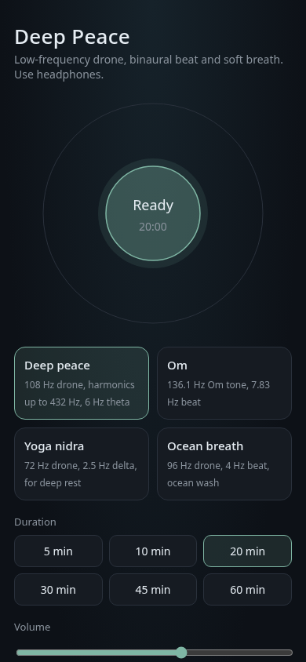

# Deep Peace

Deep Peace is a zero-dependency, low-frequency yoga sound app: one `index.html`
on the Web Audio API, served by GitHub Pages at
<https://fschmutz.github.io/DEEP-PEACE/>. The repository was created from
[`ScaleMeNow/GITHUB-TEMPLATE`](https://github.com/ScaleMeNow/GITHUB-TEMPLATE).

> **This wiki is generated.** Every page here is a file in the `wiki/` directory
> of the repository, published by `.github/workflows/wiki.yml`. Edits made in the
> GitHub wiki UI are overwritten by the next sync.

## Start here

- **[Getting Started](Getting-Started)** — how repositories from the template are set up.
- **[Bundles](Bundles)** — what runs on day one and what ships switched off.
- **[Architecture Decisions](Architecture-Decisions)** — why the repository is shaped this way.

## Screenshots

## How this wiki works

| | |
|---|---|
| Source of truth | `wiki/` in the repository |
| Published by | `.github/workflows/wiki.yml` → `scripts/wiki-sync.sh` |
| Trigger | push to the default branch touching `wiki/**`, or a manual run |
| Page name | the filename, with `-` rendered as a space |
| Links between pages | the page name, not the filename: `[Getting Started](Getting-Started)` |

Adding a page is one file: create `wiki/My-Page.md`, open a pull request, and the
merge publishes it. Deleting the file deletes the page — the sync mirrors, it does
not merge.

A new repository needs the wiki bootstrapped once by hand before any of this
works — see [Getting Started](Getting-Started), step 7.

## Why a wiki and not Pages

ScaleMeNow operator repositories are private, and a private repository cannot
serve Pages without making the docs public. The wiki inherits the repository's
access control, costs nothing to run, and stays reviewable because the source
lives in the repository.

The trade-off, stated plainly: the wiki has no custom styling and no build step.
For a public, human-facing product surface, Pages from a `docs/` directory is the
better answer — but pick **one**. Two documentation sources drift, and the
unmaintained one is the one people find.

## Conventions

- One page, one subject. A page that needs a table of contents usually wants to
  be two pages.
- Name files as titles: `Runbook-Database-Failover.md`, not `db_failover.md`.
- Write for the person on call at 03:00 who has not read the rest of this wiki.
- No secrets, no credentials, no customer identifiers. The wiki is part of the
  repository and is scanned like the rest of it.

## Repository documents

Some documents stay in the repository rather than the wiki, because GitHub renders
them in the interface where they matter:

- [`README.md`](https://github.com/fschmutz/DEEP-PEACE/blob/main/README.md) — what this is and how to use the template
- [`CONTRIBUTING.md`](https://github.com/fschmutz/DEEP-PEACE/blob/main/CONTRIBUTING.md) — branch, commit, and pull request conventions
- [`AGENTS.md`](https://github.com/fschmutz/DEEP-PEACE/blob/main/AGENTS.md) — the same conventions, as a contract for AI assistants
- [`SECURITY.md`](https://github.com/fschmutz/DEEP-PEACE/blob/main/SECURITY.md) — how to report a vulnerability privately
- [`SUPPORT.md`](https://github.com/fschmutz/DEEP-PEACE/blob/main/SUPPORT.md) — where to ask a question that is not a vulnerability
- [`CHANGELOG.md`](https://github.com/fschmutz/DEEP-PEACE/blob/main/CHANGELOG.md) — what changed and when
